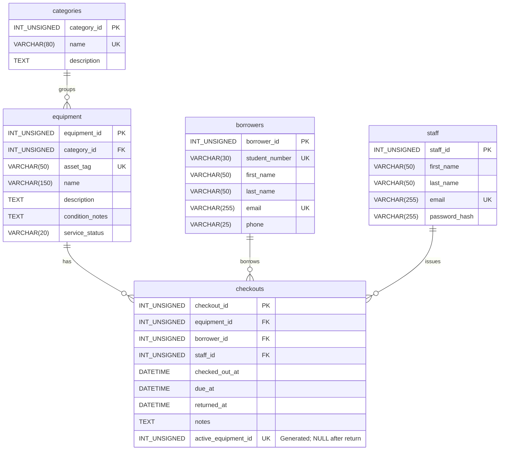

# Campus Equipment Checkout

A database-driven web app built with PHP and MariaDB. Students borrow campus equipment such as laptops, cameras, calculators, and sports equipment. Staff manage equipment, borrowers, checkouts, and returns.

## Planned Features

- Equipment management: create, view, update, and delete equipment records.
- Checkout management: create, view, update, and delete checkout records.
- Search equipment by name or category and see which items are available.
- Record due dates and actual return dates.
- View overdue items and their borrowers.

## Data Model

Each equipment row represents one physical item with its own asset tag. Each checkout records one item borrowed by one student and issued by one staff member. Borrowing several items creates several checkout records.

| Entity | Purpose | Primary key | Foreign keys |
| --- | --- | --- | --- |
| categories | Groups equipment, such as laptops or cameras | category_id | None |
| equipment | Tracks each physical item | equipment_id | category_id |
| borrowers | Stores student borrower details | borrower_id | None |
| staff | Stores staff accounts that issue equipment | staff_id | None |
| checkouts | Tracks borrowing, due dates, and returns | checkout_id | equipment_id, borrower_id, staff_id |

`INT_UNSIGNED` in the diagram means SQL `INT UNSIGNED`. All primary keys auto-increment. Each relationship is one-to-many: a parent can have zero or many child records, and each child references exactly one parent.

### Constraints and Business Rules

- Category names, asset tags, student numbers, and account emails are unique within their tables.
- Required fields use `NOT NULL`. Descriptions, condition notes, phone numbers, checkout notes, and return dates may be NULL.
- `returned_at` stays NULL until an item is returned. Due dates must be after checkout time; return dates cannot precede checkout time.
- `active_equipment_id` is computed by MariaDB. It equals the equipment ID for an unreturned checkout and becomes NULL after return. Its unique constraint prevents two active checkouts for the same item while allowing many past checkouts. Do not supply this column in INSERT or UPDATE statements.
- Equipment service status is `in_service`, `maintenance`, or `retired`. Availability is calculated from service status and active checkouts, rather than stored as a second status that could become inconsistent.
- An overdue checkout has `returned_at IS NULL` and `due_at < CURRENT_TIMESTAMP`.
- Foreign keys prevent orphan records. Equipment, borrowers, staff, and categories referenced by history cannot be deleted until their dependent records are handled. Retire equipment to preserve its borrowing history. Checkout deletion is intended for correcting erroneous records.
- The PHP app must check that equipment is in service before issuing it. Use a transaction and lock the equipment row when checking availability and creating a checkout; status changes should use the same locking approach.
- Store staff passwords using PHP `password_hash()` and verify them using `password_verify()`. Never store plaintext passwords or commit credentials.

## Load the Database

1. Start the Debian VM and open `http://<your-vm-ip>/phpmyadmin` in your browser. The last verified address was `http://10.0.0.169/phpmyadmin`; check the VM IP if that no longer works.
2. Log in with your MariaDB account.
3. Download `database/schema.sql` from this repository.
4. On the phpMyAdmin server home page, select **Import**, choose `schema.sql`, keep SQL as the format, and click **Import** (or **Go**).
5. Select `campus_equipment_checkout` in the left sidebar and open **Structure**.
6. Confirm these five tables appear: `borrowers`, `categories`, `checkouts`, `equipment`, and `staff`.
7. Take a screenshot including the browser address, database name, and all five tables. Save it as `screenshots/database-tables.png` and commit it to this repository.

The schema creates the database if needed but intentionally does not drop or replace existing tables. Import it once into a new project database. If an import reports an error, inspect it before retrying; do not delete an existing database containing work.

## Repository Contents

- `README.md`: project overview, data model, relationships, and setup instructions.
- `database/schema.sql`: database and table definitions.
- `screenshots/`: the required VM phpMyAdmin screenshot belongs here after import.

## Team

Mazin Banimineih. Additional team members will be added by the repository owner.

Use this same repository for future PHP source code, database updates, project check-ins, and the final submission. The owner will invite each teammate through repository **Settings → Collaborators**.

## Current Scope

This submission prepares the database design. The PHP application is planned for later project work. The required screenshot must show the database imported on the team's actual VM; the screenshot folder instructions are not a substitute for that evidence.
